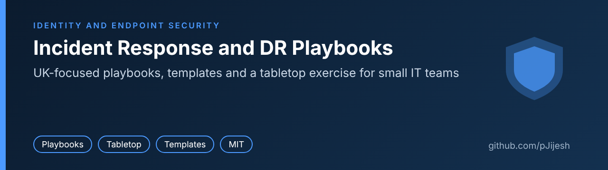
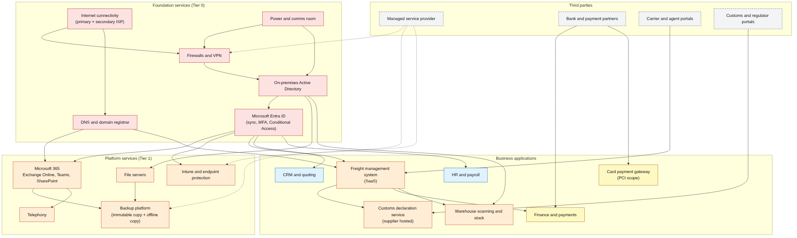

# Incident Response and DR Playbooks



[](https://github.com/pJijesh/incident-response-and-dr-playbooks/actions/workflows/ci.yml) [](LICENSE) 

**Problem:** small IT teams in regulated businesses are expected to survive ransomware, fraud, data breaches and outages, but their plans are often long, untested and unusable at 2am.

**For:** IT managers, small IT teams, and the executives and auditors who rely on them, in UK organisations running Microsoft 365 and a hybrid estate.

**Demonstrates:** resilience engineering, audit readiness and calm, clear communication under pressure, built as practical playbooks, DR templates, an exercise pack and a tested linter.

> Generic guidance, not legal advice. All example companies, systems and numbers are fictional. See [limitations](#limitations).

## The map

```text
 Something happens
       |
       v
 Detect -> Triage and declare (severity P1 to P4) -> Contain -> Eradicate -> Recover -> Review
                 |                                                               |
                 +------- Communicate and notify (ICO 72h, insurer, customers) --+
```

| Playbook | Use when | First move | Personal data? (72-hour ICO clock) |
|---|---|---|---|
| [Ransomware](playbooks/ransomware.md) | Encrypted files, ransom note, tampered backups | Isolate, protect backups, declare P1 | Assume yes until shown otherwise |
| [M365 account compromise and BEC](playbooks/m365-account-compromise-bec.md) | Phished credentials, odd mailbox rules, payment fraud | Call the bank if money moved, disable account, revoke sessions | Often (mailbox content) |
| [Personal data breach](playbooks/personal-data-breach.md) | Any incident touching personal data | Record the time of awareness | This is the playbook |
| [Lost or stolen device](playbooks/lost-or-stolen-device.md) | Laptop, phone, key or drive missing | Revoke sessions, lock or wipe | If data unprotected |
| [Critical SaaS or supplier outage](playbooks/saas-supplier-outage.md) | A dependency is down or compromised | Confirm it is not you, ticket, workarounds | If the supplier is breached |
| [DDoS and service outage](playbooks/ddos-service-outage.md) | Internet-facing service unreachable | Attack, surge or fault? Call upstream | Rarely |

Each playbook has the same 14 sections: purpose, triggers, severity matrix, roles, first 15 minutes, containment, eradication, recovery, evidence handling, communications, regulatory and contractual notifications, decision points, post-incident actions, and a one-page printable checklist.

## What is in the repository

| Folder | Contents |
|---|---|
| [playbooks/](playbooks/README.md) | Six incident playbooks with a shared structure |
| [dr/](dr/dr-plan-template.md) | [DR plan template](dr/dr-plan-template.md), [BIA template](dr/bia-template.md) with [CSV](dr/bia-template.csv) and a [worked example](dr/bia-worked-example.md), [RTO and RPO tiers](dr/rto-rpo-tiers.md), [restore test log](dr/backup-restore-test-log.md), [DR test report](dr/dr-test-report-template.md), [dependency map](dr/dependency-map.md) |
| [exercises/](exercises/README.md) | A two-hour [ransomware tabletop pack](exercises/ransomware-tabletop/README.md): timed injects, facilitator guide, handouts, evaluation form, lessons-learned template |
| [comms/](comms/README.md) | Templates for staff, customers, board, regulator and media, plus a decision log, contact sheet and blameless post-incident review |
| [tools/](tools/check_playbooks.py) | `check_playbooks.py`, a standard-library linter for playbook structure, placeholders and links, and [`check_dr.py`](tools/check_dr.py), which checks the BIA and restore test log against the tier rules |
| [tests/](tests/) | Unit tests for both tools and the DR data files |
| [docs/](docs/references.md) | [References](docs/references.md) with source status, [severity model](docs/severity-model.md), [audit mapping](docs/audit-mapping.md), dependency map image |



## Adopt it in a week

A week gets you a usable first version, not a mature programme. Block about an hour a day for the owner, plus short sessions with colleagues.

| Day | Do | Output |
|---|---|---|
| 1 | Read the [severity model](docs/severity-model.md). Name an executive sponsor, an incident manager and deputies. Fill in the [contact sheet](comms/contact-sheet-template.md) and put a printed copy somewhere that does not need your systems | Named roles, contact sheet |
| 2 | Run the [BIA](dr/bia-template.md) with three or four department leads, using the CSV | Draft BIA |
| 3 | Agree [RTO and RPO tiers](dr/rto-rpo-tiers.md), draw your [dependency map](dr/dependency-map.md), list the gaps (for example untested backups, a single admin identity). Run `python tools/check_dr.py --bia your-bia.csv` to catch tiers that contradict each other | Signed-off tiers, gap list |
| 4 | Adapt the playbooks: swap in your tools, insurer, MSP and customer obligations; delete what does not apply; run `python tools/check_playbooks.py --all-links` | Playbooks that match your environment |
| 5 | Do one restore test of a Tier 1 system and record it in the [test log](dr/backup-restore-test-log.md). Print the section 14 checklists. Re-run `check_dr.py` with `--restore-log` to see what is still untested | First evidence of a tested restore |
| 6 | Run the 90-minute [tabletop](exercises/ransomware-tabletop/facilitator-guide.md#shorter-variants) with the response team | Scored evaluation form |
| 7 | Complete the [lessons-learned record](exercises/ransomware-tabletop/lessons-learned-template.md), agree the top five actions and dates with the sponsor | Owned action list |

Then keep it alive: review annually and after every incident, test restores to the schedule in the tier table, and re-run an exercise every 6 to 12 months.

## Quality checks

```bash
python tools/check_playbooks.py --all-links     # lint playbooks and every internal link
python tools/check_dr.py                        # check the worked-example BIA and restore log
python -m unittest discover -s tests -v         # run the tests
```

The linter requires every playbook to contain the 14 sections in order with content, a one-page checklist with enough tick boxes, a metadata table with a review date, no TODO, FIXME or TBD markers, no broken internal links or heading anchors, and no em-dashes. It prints a summary table and exits non-zero on errors. It uses only the Python standard library (3.10 or later). CI runs both commands on every push and pull request.

The linter checks structure, not quality. It cannot tell you whether a playbook is any good. Only exercises and real incidents can.

### DR gap report

`tools/check_dr.py` applies the rules in the [tier table](dr/rto-rpo-tiers.md) to your numbers. Give it a BIA CSV and, optionally, a restore test log:

```bash
python tools/check_dr.py --bia dr/bia-worked-example.csv --restore-log dr/backup-restore-test-log-worked-example.csv --as-of 2026-11-02
```

| Rule | What it checks | Level |
|---|---|---|
| DR01 to DR03 | Columns and numbers are valid; tier is T0 to T4; RTO and RPO sit inside the tier maximum; RTO is shorter than MTPD | Error |
| DR04, DR05 | A process does not promise a faster RTO, or sit in a faster tier, than a system it depends on | Error |
| DR06, DR07 | Impact ratings rise with outage length; dependencies that match no process are listed | Warning, note |
| DR10 | A restore recorded as Pass that missed its own RTO or RPO | Error |
| DR11 to DR13 | No restore test on record, latest test overdue for its tier, or latest test failed or missed the BIA targets | Warning |

The [example report](docs/dr-gap-report-example.md) shows the output for the fictional Fernhill Freight data, and CI checks that it is current. When this tool was first run on the worked example it found a real inconsistency in it (payroll in Tier 2 depending on an HR system in Tier 3), which is now fixed and explained in the [worked example](dr/bia-worked-example.md). The tool matches a process to a restore test by system name, so check the matches that matter. It cannot tell you whether a restore test was honest.

## Limitations

- **Not legal advice.** The ICO, NCSC and Report Fraud references reflect public guidance read on 4 November 2026 (see [references](docs/references.md)). Laws and guidance change. Take advice from your Data Protection Officer or a solicitor for anything borderline, and check the current guidance before relying on it.
- **Adapt it.** It assumes a small or mid-size UK organisation using Microsoft 365 with a hybrid Active Directory. Your tools, contracts, insurance policy, customer terms and sector rules will differ. Timings, tiers and severity targets are starting points, not standards.
- **Commands are untested in your tenant.** The PowerShell examples are based on Microsoft documentation and were not executed against a live tenant for this repository. Test them first.
- **Sector duties are not stated.** The playbooks prompt you to check customs authorisations, card scheme rules, insurer conditions and contractual notice periods, but do not assert specific duties, because those depend on your agreements and authorisations.
- **Not a certification kit.** The [audit mapping](docs/audit-mapping.md) shows where artefacts can serve as evidence. It does not make anyone compliant, and the standards' control wording should be checked in the standards themselves.
- **Out of scope:** operational technology and safety systems, physical security and building emergencies, people-continuity planning, and detection engineering.
- **Examples are fictional.** Fernhill Freight Ltd and its systems are invented. No real organisation, person, incident or statistic is used.

## Roadmap

Planned, not promised. Order and timing change with other work.

- **Next:** Add manufacturing site outage playbook; Add supplier compromise playbook
- **Then:** Add data loss tabletop exercise; Recheck UK regulator notification guidance
- **Later:** Release v1.1

## Contributing

Corrections, clearer wording and extra playbooks are welcome. See [CONTRIBUTING.md](CONTRIBUTING.md).

## Author

Written by Puliyappottammal Jijesh, an IT manager responsible for disaster recovery and cyber incident response in a regulated UK environment, where ISO 27001 and PCI-style audit expectations shape what "ready" has to mean. This repository is a generic, personal project and contains no employer material.

[GitHub: pJijesh](https://github.com/pJijesh) | [LinkedIn: pjijesh](https://www.linkedin.com/in/pjijesh)

## Licence

[MIT](LICENSE), 2026 Puliyappottammal Jijesh.
