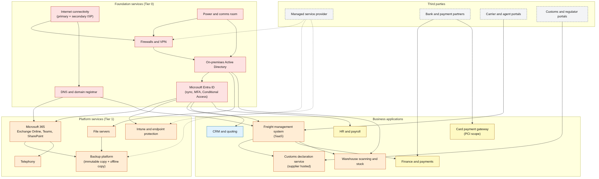
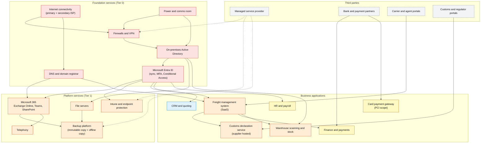

# Dependency map

A dependency map shows what must be working for each service to work. It answers the question the [BIA](bia-template.md) cannot: "if X fails, what else goes down with it?". Use it to check tier assignments (a service cannot be recovered faster than the things it depends on) and to decide the recovery order in the [DR plan](dr-plan-template.md).

The diagram is for a fictional mid-size company with Microsoft 365 and hybrid Active Directory, matching the [BIA worked example](bia-worked-example.md). Replace the boxes with your own services.



Reading it: an arrow from A to B means "B depends on A" (if A fails, B is affected). Colours show the recovery tier from the [tier table](rto-rpo-tiers.md): red is Tier 0 (foundation), orange is Tier 1, yellow is Tier 2, blue is Tier 3, and dashed grey boxes are third parties you do not control. Dotted arrows show the managed service provider's access or support role.

## Source

The diagram source is [dependency-map.mmd](dependency-map.mmd). GitHub renders the Mermaid block below directly. The PNG in `docs/` is produced from the same source with the Mermaid command line tool:

```bash
npm install -g @mermaid-js/mermaid-cli
mmdc -i dr/dependency-map.mmd -o docs/dependency-map.png -w 1800 -b white
```



## How to build your own in an hour

1. List your business processes from the BIA and the systems each one uses.
2. For each system, ask: what does it need to run? Typical answers are identity, network, DNS, power, a database, a supplier, a licence, a person with specific knowledge.
3. Add arrows from the dependency to the dependent service.
4. Colour by tier. Any arrow that goes from a lower tier (slower recovery) into a higher tier (faster recovery) is a problem to fix, either by raising the dependency's tier or by accepting and recording the risk.
5. Mark single points of failure: one firewall, one ISP, one person, one supplier.
6. Review after every major change, and after every incident or test.

## What to look for

| Finding | Example response |
|---|---|
| A T1 service depends on something with no recovery plan | Add it to the DR plan and the test schedule |
| One identity platform feeds everything | Treat identity as T0, keep break-glass accounts and a tested rebuild |
| One supplier appears under many services | Review the contract, incident contacts and service levels against the strictest RTO |
| A dependency is a person | Document the procedure and train a deputy |
| Backups depend on the same identity as production | Separate the backup administration credentials |
