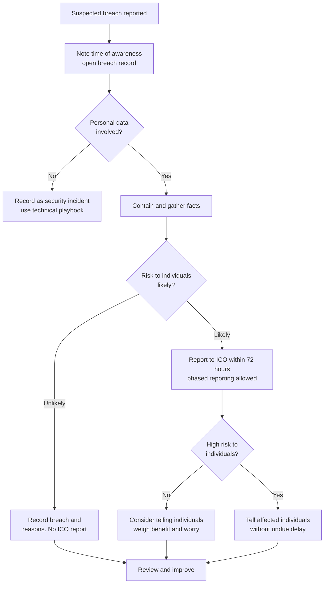

# Playbook: Personal data breach (UK GDPR)

| Field | Value |
|---|---|
| Version | 1.0 |
| Owner | IT Manager, with the Data Protection Lead (DPO where appointed) |
| Last reviewed | 2026-11-04 |
| Review cycle | At least every 12 months, and after every real incident or exercise |
| Related | [Ransomware](ransomware.md), [M365 account compromise](m365-account-compromise-bec.md), [Lost or stolen device](lost-or-stolen-device.md), [Regulator notification template](../comms/regulator-notification.md) |

> This playbook summarises ICO guidance as at 4 November 2026 and is not legal advice. The legal test is in the UK GDPR and the Data Protection Act 2018, and guidance changes. Check the current ICO pages linked in [references](../docs/references.md#data-protection-and-the-ico) and take advice from your DPO or a solicitor for anything borderline.

## 1. Purpose

To make sure that every suspected personal data breach is recorded, assessed and, where required, reported to the ICO within 72 hours of becoming aware and communicated to affected people without undue delay, with decisions evidenced.

A personal data breach is a security incident that affects the confidentiality, integrity or availability of personal data. It includes accidental loss, wrong-recipient emails, stolen devices, hacking, ransomware and unauthorised internal access. It is not only "hacking".

## 2. Triggers

Run this playbook, in parallel with any technical playbook, when:

- Personal data may have been accessed, disclosed, altered, lost or made unavailable without authority.
- Any other incident (ransomware, account compromise, lost device, supplier breach) involves systems that hold personal data of customers, staff, contacts, drivers, consignees or others.
- A supplier or processor tells you they have had a breach affecting your data. A processor must inform the controller without undue delay once it becomes aware.
- A member of the public, customer, or staff member reports they received data that is not theirs.
- A threat actor claims to hold your data.

Staff should be told to report suspected breaches immediately and without fear of blame. Internal reporting is the start of the clock for your own team, and the legal clock starts when the organisation becomes aware, so slow internal escalation uses up time you will want later.

## 3. Severity matrix

Severity here follows the likely risk to individuals, then the shared response targets apply. See the [severity model](../docs/severity-model.md).

| Level | Assessment | Typical action |
|---|---|---|
| P1 Critical | High risk to individuals' rights and freedoms (for example special category data, financial data, identity documents, large volumes, vulnerable people, likely harm such as fraud or physical safety) | Report to ICO within 72 hours and inform individuals without undue delay |
| P2 High | A risk to individuals is likely, but not high | Report to ICO within 72 hours. Telling individuals is optional but often helpful, weigh the benefit |
| P3 Medium | A risk is unlikely (for example encrypted device lost with keys secure, a recipient who confirms deletion) | Do not report to the ICO but record the breach and the reasoning |
| P4 Low | Near miss with no personal data compromised | Log for trend analysis |

Wording follows the ICO guide: report if a risk to individuals is likely, and inform individuals directly if there is a high risk.

## 4. Roles

| Role | Breach-specific duties |
|---|---|
| Incident Manager | Runs the response, keeps the 72-hour clock visible, ensures decisions are logged |
| Data Protection Lead (DPO) | Owns the risk assessment, the ICO decision and the content of notifications |
| Technical Lead | Establishes what data, how many records, which systems, how it was exposed, and contains the breach |
| Communications Lead | Drafts individual notices and holding statements with the Data Protection Lead |
| Executive Sponsor | Signs off notifications and resources |
| Scribe | Maintains the breach record and timeline |
| Supplier liaison | Processors and joint controllers, legal advisers, insurer |

## 5. First 15 minutes

1. **Write down the time you became aware.** The ICO states that the 72 hours run from awareness, not from when the breach happened. The legal text sets 72 hours rather than working days, so plan as if weekends and bank holidays count.
2. **Open a breach record** (use the fields in section 9 or your breach register).
3. **Stop the breach continuing**: recall the email, revoke the access, disable the account, wipe the lost device, take down the exposed link. See the relevant technical playbook.
4. **Capture the first facts**: what happened, when, how you found out, what data, whose data, roughly how many people, what has been done.
5. **Tell the Data Protection Lead and the Incident Manager.** Do not wait for the full picture.
6. **Do not delete evidence** and do not contact affected people yet unless advised, to avoid inconsistent messages.

## 6. Containment

- Recover the data where possible: ask an unintended recipient to delete it and to confirm in writing; recall messages; remove public links; retrieve or remotely wipe devices.
- Remove the cause of exposure: fix the misconfiguration, revoke the credential, close the access route.
- Protect the most affected people first. If there is a risk of immediate harm (for example a safeguarding risk, a home address of a vulnerable person, or identity documents), prioritise that and involve the police if appropriate.
- Limit onward sharing: instruct staff not to forward the material; if a processor holds the data, instruct them in writing.
- Record each containment step and its time.

## 7. Eradication

- Identify the root cause: human error, process gap, technical misconfiguration, malicious actor, supplier failure.
- Eliminate the cause: change the process, fix the configuration, revoke the access path, add the missing control.
- Where the incident is a cyber attack, follow the relevant playbook for eradication. This playbook only adds the data protection tasks.
- Confirm no further data is exposed, for example by re-testing that the link no longer resolves or that the credential no longer works.

## 8. Recovery

- Restore availability of personal data if it was lost or made unavailable, from backups, following the [DR plan](../dr/dr-plan-template.md). Loss of availability can itself be a breach, so record how long people were affected.
- Correct any data that was altered. Notify the people whose records were corrected, if it affected them.
- Confirm that notifications, and any support offered to individuals (for example advice on passwords, fraud alerts, or phishing warnings), have been delivered.
- Keep monitoring for misuse of the data, such as phishing using stolen details.

### Risk assessment: ICO and individuals

Use a short written assessment for every breach. The assessment is for the likely consequences for the people concerned, not for the business.

| Factor | Questions to answer |
|---|---|
| Type of breach | Confidentiality (disclosure or access), integrity (alteration), availability (loss or destruction)? |
| Data | What categories? Special category data, criminal offence data, financial data, identity documents, contact details, location or shipment data that reveals home addresses? |
| Volume and people | How many records and individuals? Any children or vulnerable people? |
| Ease of identification | Can individuals be identified directly or easily by the recipient? Was the data encrypted and the key safe? |
| Consequences | Possible harms: identity theft or fraud, financial loss, discrimination, loss of confidentiality, physical safety, distress, loss of control |
| Mitigation | Was the data recovered or deleted? Is there confirmation? |
| Recipient | Trusted, unknown or malicious? |
| Duration | How long was it exposed? |

Outcome options, to be recorded with reasons: (a) risk unlikely, record only; (b) risk likely, report to ICO; (c) high risk, report to ICO and tell individuals.

## 9. Evidence handling

The accountability principle means you must be able to show your reasoning. Record every breach, including those not reported to the ICO, and keep the following in the breach register:

| Field | Content |
|---|---|
| Reference and dates | Incident reference, date and time of breach (if known), date and time of awareness, date reported internally |
| Description | What happened, in plain English |
| Data and people | Categories of data, categories and approximate number of individuals and records |
| Cause | Root cause and contributing factors |
| Effects | Actual and likely consequences for individuals |
| Actions | Containment, remedial steps and dates |
| Assessment | Risk assessment and the decision on ICO and individual notification, with the name of the decision-maker and reasons |
| Notifications | ICO case reference, date sent, follow-ups, individual notification date and method |
| Lessons | Actions arising, owners and dates |

Preserve logs, emails and forensic evidence as described in the technical playbook. Keep the breach register and decision log as part of your records for audit and for any later ICO enquiry.

## 10. Communications

### To the ICO

Report using the ICO's online breach report or its breach helpline (see [references](../docs/references.md#data-protection-and-the-ico)). Use the [regulator notification template](../comms/regulator-notification.md) to prepare the content in advance. The ICO notification must include, where possible:

- The nature of the breach, including categories and approximate numbers of individuals and records.
- Contact details of the DPO or another contact point.
- The likely consequences.
- The measures taken or proposed to address the breach and reduce possible harm.

If you do not have all the facts within 72 hours, report with what you have and say that more will follow. The ICO guidance allows information to be provided in phases without undue further delay. If you report after 72 hours, give the reasons for the delay.

### To individuals

Where there is a high risk, tell the people affected directly and without undue delay, in clear and plain language. Use the [customer notice](../comms/customer-notice.md) or [staff notice](../comms/staff-notice.md) as a base, and include:

- What happened, in plain terms.
- The likely consequences for them.
- What you have done and are doing.
- What they can do to protect themselves (for example change passwords, watch for phishing, check statements).
- A named contact point.

Avoid jargon, blame and false reassurance. Do not tell individuals the issue is "fully resolved" until it is.

### To staff and media

Use the [staff notice](../comms/staff-notice.md) and [media holding statement](../comms/media-holding-statement.md) if needed. Do not release names or details of affected people to anyone who does not need them.

## 11. Regulatory and contractual notifications

| Who | Trigger | Deadline |
|---|---|---|
| ICO | Breach likely to result in a risk to individuals' rights and freedoms | Without undue delay and within 72 hours of becoming aware, with phased reporting allowed |
| Individuals | Breach likely to result in a high risk | Without undue delay |
| Controller (if you are the processor) | Any personal data breach affecting the controller's data | Without undue delay once aware, and check the data processing agreement for tighter terms |
| Processors and joint controllers | Where they hold affected data, so they can act | Promptly, in line with the contract |
| Customers (as controllers) | Where you process their data and the breach affects it | As per contract, often shorter than 72 hours |
| Insurer | Where cover may respond | As per policy |
| Police and Report Fraud | Where crime is suspected | Promptly |
| NCSC | Cyber attacks | Report via the NCSC reporting service. The NCSC does not share reports with the ICO, so report separately to each |
| Card acquirer or payment brands | Cardholder data may be involved | As per merchant agreement |
| Other regulators and certifiers | As required by sector rules or certification terms | Check your obligations |

If you are not sure whether a report is needed, the ICO provides a self-assessment tool and an advice line, listed in [references](../docs/references.md#data-protection-and-the-ico).

## 12. Decision points

| # | Decision | Owner | Evidence in the log |
|---|---|---|---|
| D1 | Is personal data involved? | Data Protection Lead | Systems and data categories affected |
| D2 | Time of awareness | Incident Manager | Who knew what and when |
| D3 | Is a risk to individuals likely, unlikely or high? | Data Protection Lead | Completed risk assessment |
| D4 | Report to the ICO now, or report in phases? | Data Protection Lead and Executive Sponsor | Facts known at the 24 and 48 hour marks |
| D5 | Tell individuals? How and when? | Data Protection Lead, Communications Lead | Draft notice and approval |
| D6 | Do we need to inform other bodies or customers by contract? | Incident Manager | Contract and policy checks |
| D7 | Close the breach record | Data Protection Lead | Actions agreed and notifications complete |

Suggested internal checkpoints: a first assessment by hour 4, a draft ICO report ready by hour 24, a decision on individual notification by hour 36, and the final submission before hour 72. These are planning aids, not legal requirements.

## 13. Post-incident actions

- Complete the breach register entry and attach the evidence.
- Blameless [post-incident review](../comms/post-incident-review-template.md), with root-cause analysis and corrective actions.
- Data protection improvements: data minimisation and retention reviews, access reviews, encryption at rest and in transit, email recipient safeguards (for example warnings on external recipients), DLP rules, supplier due diligence and contract terms.
- Training based on the real case, with names removed.
- Review whether a Data Protection Impact Assessment needs updating.
- Respond to any ICO follow-up questions, and record the outcome.
- Audit trail for ISO 27001 and similar assessments: link the breach register entry to the corrective action log.

## 14. Quick-reference checklist

- [ ] Write down the time you became aware (this is the start of the 72-hour clock)
- [ ] Open a breach record and the decision log
- [ ] Contain: recall, revoke, disable, wipe, take down, retrieve
- [ ] Tell the Data Protection Lead and the Incident Manager
- [ ] Establish: what data, whose, how many, how exposed, what recovered
- [ ] Complete the written risk assessment (likely harm to individuals)
- [ ] Decide and log: record only, report to ICO, or report and tell individuals
- [ ] If reporting: use the ICO online form or helpline; give what you know and say more follows
- [ ] If high risk: tell individuals directly, in plain language, with advice and a contact
- [ ] Notify controllers, processors, customers, insurer, card acquirer as contracts require
- [ ] Report crime to Report Fraud (or Police Scotland) and cyber attacks to the NCSC
- [ ] Preserve evidence; update the breach register with reasoning
- [ ] Close actions after the blameless review
